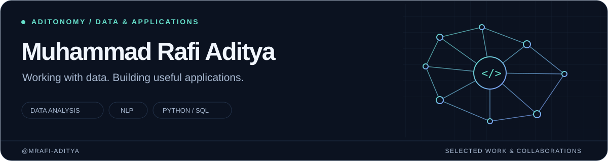

<picture>
  <source media="(prefers-color-scheme: light)" srcset="./assets/profile-light.svg">
  
</picture>

# Hi, I'm Rafi 👋

I'm **Muhammad Rafi Aditya**, also known as **Aditonomy** — an Informatics student interested in **machine learning, natural language processing, and web development**. I build research demos and university projects, and collaborate with a team on applications for clients.

[Selected projects](#selected-projects) · [In development](#currently-building) · [Collaborations](#collaborations--contributions) · [All repositories](https://github.com/mrafi-aditya?tab=repositories)

## Currently building

Two ongoing team projects. **My role: collaborator / contributor.** Both are **in development** and their source code is private.

<table>
  <tr>
    <td width="50%" valign="top">
      <h3>Fotomotif</h3>
      
<strong>🟡 In development</strong> · Team project

      
A motorcycle photography marketplace that helps riders discover photos of their bikes.

      
<strong>My focus:</strong> visual-search model integration, saved-motor workflows, and checkout/payment flows.

      
SvelteKit · TypeScript · Python · PostgreSQL · Midtrans

    </td>
    <td width="50%" valign="top">
      <h3>Raffseal Dashboard</h3>
      
<strong>🟡 In development</strong> · Team project

      
An internal business dashboard being developed with the Raffseal team.

      
<strong>My focus:</strong> dashboard workflows, role-based access, and purchase-order document features.

      
PHP · Laravel · Filament · Livewire

    </td>
  </tr>
</table>

## Selected projects

A few projects from my work in applied ML, networking, and interactive web experiences.

<table>
  <tr>
    <td width="50%" valign="top">
      <h3>01 / Goat Disease Classification</h3>
      
A research demo for image-based classification of goat diseases, with an EfficientNetB0 model and a Streamlit interface.

      
Python · TensorFlow / Keras · Streamlit

      <a href="https://github.com/mrafi-aditya/web_streamlit_kambing">Explore repository →</a>
    </td>
    <td width="50%" valign="top">
      <h3>02 / Stress Detection with NLP</h3>
      
A Streamlit project exploring text-based stress detection with machine learning and language models.

      
Python · PyTorch · Transformers · Streamlit

      <a href="https://github.com/mrafi-aditya/Stress-Detection-Web-ML">Explore repository →</a>
    </td>
  </tr>
  <tr>
    <td width="50%" valign="top">
      <h3>03 / K-Stage Hub</h3>
      
A K-pop fan community project with TCP file uploads, UDP video streaming, and chat, built for a networking course.

      
Python · Streamlit · TCP / UDP · Docker

      <a href="https://github.com/mrafi-aditya/netstream_web_uas">Explore repository →</a>
    </td>
    <td width="50%" valign="top">
      <h3>04 / Movase</h3>
      
An interactive 3D web project built for computer graphics coursework.

      
JavaScript · HTML · glTF

      <a href="https://github.com/mrafi-aditya/Web-Based-Simple-Interactive">Explore repository →</a> · <a href="https://movase-one.vercel.app">Web demo ↗</a>
    </td>
  </tr>
</table>

**More coursework:** [MovieLibrary — React & PHP](https://github.com/mrafi-aditya/PWEB_Ujian) · [TCP / UDP socket programming](https://github.com/mrafi-aditya/PJAR_Socket-UDP-dan-TCP) · [3D model & shadows](https://github.com/mrafi-aditya/Web-Based-Simple-Model-Shadow)

## Collaborations & contributions

Alongside my own repositories, I work with others on shared projects.

| Project | My involvement | Project overview |
| :--- | :--- | :--- |
| [Libo](https://github.com/azra-ahmad/libo) | Contributor | A desktop library management application using Java Swing, Spring Boot, and MySQL. |
| [Katalog Film](https://github.com/azra-ahmad/katalog-film) | Collaborator | A movie catalog and admin interface using PHP and CodeIgniter. |
| [Klinik Kecantikan](https://github.com/Wassabie/klinik_kecantikan) | Collaborator | A PHP website project for a beauty clinic. |

## Tools I work with

**ML & data** — Python, PyTorch, TensorFlow / Keras, Transformers, NumPy, pandas  
**Web & applications** — Streamlit, JavaScript / TypeScript, React, SvelteKit, PHP, Laravel  
**Supporting tools** — Git, Docker, PostgreSQL, MySQL, TCP / UDP sockets

---

Learning through projects, building with a team, and documenting the process.

